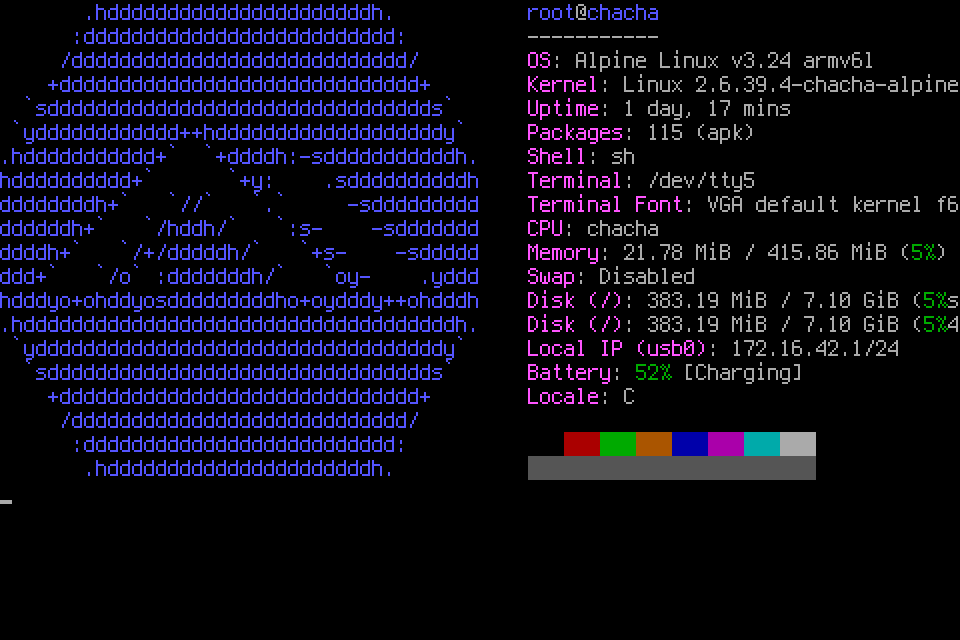
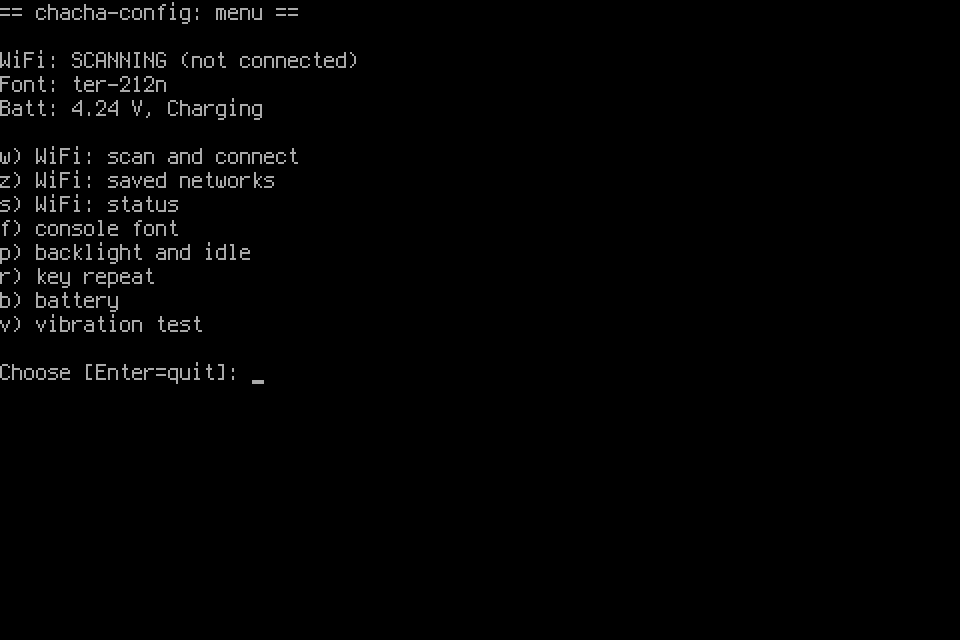

# Alpine Linux on the HTC ChaCha (A810e)

Turns an HTC ChaCha (the 2011 "Facebook phone" with a QWERTY keyboard) into a
small Linux terminal: plain Alpine Linux 3.24 (armhf) on the SD card, booted by
a patched HTC kernel from the phone's boot partition. Framebuffer console with
80×26 characters, the hardware keyboard, WiFi, SSH, tmux, vim. No GUI.

postmarketOS dropped armhf in June 2026, so this is plain Alpine with its own
kernel build and initramfs.



## What works

| | |
|---|---|
| Kernel | 2.6.39.4-chacha-alpine (really HTC's 2.6.35 with a bumped version), gcc 4.7 from AOSP |
| Boot | boot partition (NAND) → initramfs → `switch_root` to the SD card (ext4), about 60 s |
| Screen | fbcon 480×320, 16 colours, Terminus fonts from 6×12 (80×26) to 16×32; brightness |
| Keyboard | own keymap (FN = printed symbols, SYM = Ctrl, green call key = Esc), held-key repeat |
| Touch keys | Home / Menu / Back / Search under the screen → Ctrl+B / Tab / Esc / Ctrl+R |
| WiFi | BCM4329, 2.4 GHz, WPA/WPA2-PSK and open networks, scan/connect menu |
| USB | RNDIS network: phone `172.16.42.1`, computer `172.16.42.2`, SSH by key, NAT for internet |
| Power | battery voltage, screen/keyboard backlight off when idle, power key: screen off / hold 3 s to power off |
| Other | vibration motor; bonus: Cataclysm: DDA 0.D builds and runs (see the end) |
| Not working | touchscreen input (except the four keys), audio, telephony, GPS, camera, 5 GHz, RTC (clock comes from NTP) |

## Before you start

- **Unlocked bootloader** (HTCdev unlock): the HBOOT screen must show `*** UNLOCKED ***`.
  S-ON is fine. Tested on `CHACHA PVT SHIP S-ON RL`, HBOOT 1.10.0000.
- **Rooted Android** (e.g. CyanogenMod) with busybox and USB debugging, for the backup.
  The WiFi firmware is copied from your phone because it may not be redistributed.
- **A microSD card** of 1 GB or more. It is erased.
- **A Linux computer**; tested on Debian 13 (x86_64).
- Flashing replaces Android's kernel on the boot partition, so Android stops starting
  until you put the backup back (`restore`). Android's system and data partitions are not
  touched.
- This was developed and tested on one phone. The guided script below runs the same
  commands that were used during development, but it has not been run from start to end on
  another phone. Read what each step does before you confirm it.

Host packages (Debian/Ubuntu):

```sh
sudo apt install adb fastboot mkbootimg git curl gcc make perl python3 \
    e2fsprogs qemu-user-static binfmt-support netcat-openbsd
```

`qemu-user-static` runs ARM binaries during the build (the helper tools are compiled in an
armhf chroot); `/proc/sys/fs/binfmt_misc/qemu-arm` must exist.

You also need an SSH key (`~/.ssh/id_ed25519.pub`, or set `AUTHORIZED_KEYS=file`): it is
the only way to log in over the network.

## Installation

`scripts/chacha-install.sh` walks through the installation one step at a time. Every step
that writes to the phone asks you to type a confirmation word, and `boot` and `flash` refuse
to run without a verified backup.

```sh
git clone https://github.com/highcmd/alpine-htc-chacha.git
cd alpine-htc-chacha

scripts/chacha-install.sh check      # host tools; phone on Android with adb and root
scripts/chacha-install.sh backup     # WiFi firmware + boot/recovery partitions, verified
scripts/chacha-install.sh build      # kernel, boot image, rootfs (asks for sudo)
scripts/chacha-install.sh boot       # boot Alpine from RAM, nothing is written
scripts/chacha-install.sh sd-format  # new SD card: one partition (erases the card)
scripts/chacha-install.sh sd-write   # rootfs onto the card (erases the card)
scripts/chacha-install.sh boot       # again: now Alpine starts from the card
scripts/chacha-install.sh flash      # make it permanent: boot image onto the boot partition
```

To go back to Android: `scripts/chacha-install.sh restore`.

### The USB network on the computer

The phone appears as a USB network interface with a fixed MAC address
(`02:c4:a0:00:00:01`). With NetworkManager, create a profile once, otherwise it removes a
manually set address:

```sh
sudo nmcli con add type ethernet con-name chacha-usb ifname '*' \
    802-3-ethernet.mac-address 02:C4:A0:00:00:01 \
    ipv4.method manual ipv4.addresses 172.16.42.2/24 ipv4.never-default yes \
    ipv6.method disabled
ping 172.16.42.1
```

Without NetworkManager: `sudo ip addr add 172.16.42.2/24 dev enx02c4a0000001`.

Internet for the phone over USB (after each reboot of the computer):
`sudo config/host-usb-nat.sh`. The phone's USB route has metric 500, so WiFi wins when
it is connected.

### What the steps do

1. **backup** copies `/system/etc/firmware/fw_bcm4329*.bin` to `recon/firmware/` and the
   boot (`mtd2`, 3407872 B) and recovery (`mtd1`, 5242880 B) partitions to `backup/`
   through their read-only device nodes. The old adbd has no `exec-out` and turns LF into
   CRLF, so the data goes through `busybox base64`. Each file is checked against a
   SHA-256 computed on the phone; the sums go to `backup/SHA256SUMS`. Both directories
   are in `.gitignore`.
2. **build** runs `scripts/fetch.sh` (AOSP arm-eabi-4.7 toolchain, kernel source,
   Alpine busybox-static, apk.static), `scripts/build-kernel.sh` (→ `out/zImage`,
   `out/bcm4329.ko`), `scripts/build-bootimg.sh` (→ `out/boot-alpine.img`) and
   `scripts/build-rootfs.sh` (→ `out/rootfs.ext4`, 512 MB, grown to the whole partition on
   first boot).
3. **boot** reboots into the bootloader and runs `fastboot boot`, which only loads the image
   into RAM. With no rootfs on the card, the initramfs stays in a rescue shell:
   `nc 172.16.42.1 23`.
4. **sd-format** / **sd-write** partition the card and stream the gzipped image over the USB
   network into `dd` on the phone, then compare SHA-256 of the card with the image. (Writing
   through Android's USB mass storage froze the phone, hence the network.)
5. **flash** runs `fastboot flash boot out/boot-alpine.img`. Check the written image with
   `ssh root@172.16.42.1 "head -c $(stat -c %s out/boot-alpine.img) /dev/mtd2ro | sha256sum"`
   against `out/boot-alpine.img.sha256`.

## Using it

The console logs in as root automatically on the phone. Over USB: `ssh root@172.16.42.1`.

### Keyboard

| Key | Gives |
|---|---|
| FN + key | the printed symbol: digits 1–9, `( ) ! $ % & @ / _ - + = ' " :` |
| FN + V / FN + Y | `^` / `<` |
| Shift+FN + Y | `>` |
| FN + SYM / `,` / `?` / `.` / Tab | `0` / `#` / `;` / `:` / `*` |
| Shift+FN + Q A W S E D | `[ ] { } < >` |
| Shift+FN + T G U J K V | `\| \ ~ ` ^ €` |
| SYM | Ctrl |
| green call key | Esc |
| red call key | Alt (Meta) |
| Facebook key | `\|` |
| FN + arrows | PgUp / PgDn / Home / End |
| Shift + ↑/↓, Vol± | console scrollback |
| FN + DEL | Delete |
| Power | short press: screen off/on; hold 3 s: power off |
| Power + Vol Up + Vol Down | reset |

The keymap is generated by `config/gen-keymap.py`
(`python3 config/gen-keymap.py > /etc/keymaps/chacha.map; loadkeys /etc/keymaps/chacha.map`).
Ctrl+S / Ctrl+Q flow control is off on the console, so SYM+S does not freeze it.

The touch keys under the screen are set in `/etc/conf.d/chacha-touchkeys` (Linux key codes,
`+` joins a combination: 183 = SYM/Ctrl, 231 = Esc, 15 = Tab).

### chacha-config

`chacha-config` is a menu for the phone's settings, on the console or over SSH. Items are
chosen with letters (digits need FN); Enter goes back.



- `w` scan for WiFi networks, choose one, enter the password, connect; `1` is a hidden
  network. `z` saved networks (remove). `s` connection status.
- `f` console font: Terminus regular or bold (ISO 8859-2) from 6×12 to 16×32, plus a few
  others, each shown with the columns × rows it gives. The font is applied at once and
  reverts after 20 s unless confirmed with `y`.
- `p` screen brightness (reverts after 15 s unless confirmed), keyboard backlight, touch-key
  backlight, and the idle time after which all backlights go off. The key or touch that
  wakes the screen is not typed.
- `r` held-key repeat: delay and rate (the keypad driver has none of its own).
- `b` battery: voltage, status, charger, current, temperature. The kernel's percentage
  follows the original 1250 mAh cell's curve, so the voltage is the better guide with
  another battery (about 4.2 V full, 3.4 V empty).
- `v` vibration test. The motor is `/sys/class/timed_output/vibrator/enable`
  (`echo 500 >` vibrates for 500 ms).

Settings are kept in `/etc/conf.d/` (`chacha-backlight`, `chacha-idle`, `consolefont`) and
in `/etc/wpa_supplicant/wpa_supplicant.conf`.

### WiFi by hand

```sh
wpa_passphrase "SSID" >> /etc/wpa_supplicant/wpa_supplicant.conf   # type the password
rc-service wpa_supplicant-chacha restart
wpa_cli -i wlan0 status
```

2.4 GHz only. The regulatory country is set in `/etc/conf.d/wifi-country` (default `PL`,
channels 1–13): set your own country code there.

### Rescue

- Shell without SSH: `nc 172.16.42.1 23` (started before OpenRC).
- To the bootloader from Alpine: `reboot-bootloader`.
- Hung phone: Power + Vol Up + Vol Down resets it while the kernel still runs; a hung
  kernel needs the battery taken out (Power alone does not reset).

## Notable problems solved

1. musl's TLS register access needs `HAS_TLS_REG` on this ARMv6K core, otherwise every
   Alpine program segfaults.
2. `DEVTMPFS` hangs this kernel at boot; printk to fbcon deadlocks msm_fb (`console=null`).
3. No `getrandom()`: haveged starts before OpenRC, otherwise sshd and boot wait for minutes.
4. HTC's kernel sets `dirty_writeback_interval` to 0 until Android's early-suspend, so
   without `vm.dirty_writeback_centisecs = 500` an unclean reboot loses every file written
   since boot.
5. OpenRC services that fail on 2.6.35 (`checkpath` through the `/var/run` symlink, ambient
   capabilities) have replacements: `wpa_supplicant-chacha`, `ntpd-legacy`.
6. The keypad driver has no autorepeat; `chacha-idle` repeats held keys by writing events
   back into the input device.

The full engineering log, including dead ends, is in [NOTES.md](NOTES.md); the phone's
reconnaissance in [recon/SUMMARY.md](recon/SUMMARY.md).

## Repository

```
scripts/chacha-install.sh   guided installation (start here)
scripts/                    fetch, build-kernel, build-bootimg, build-rootfs, write-sd, build-cdda
kernel/                     patch and .config for Marvellousteam/android_kernel_htc_msm7227@kk
initramfs/                  /init and the initramfs file list
config/rootfs-overlay/      files copied onto the rootfs (OpenRC services, chacha-config, ...)
config/gen-keymap.py        console keymap generator
config/host-usb-nat.sh      internet for the phone through the computer
tools-src/                  chacha-idle, chacha-touchkeys, wlpriv, reboot-bootloader (C)
recon/                      what the phone reported under Android (no identifying data)
NOTES.md                    engineering log
```

`work/`, `out/`, `backup/`, the WiFi firmware and the raw dumps from the phone (which contain
its IMEI, serial number and MAC address) are in `.gitignore`.

## License

MIT (see [LICENSE](LICENSE)), except `kernel/`, which is a patch and configuration for the
Linux kernel and is GPL-2.0 like the kernel (see [kernel/LICENSE](kernel/LICENSE)).

## Bonus: Cataclysm: Dark Days Ahead

`sudo scripts/build-cdda.sh [VERSION]` builds the curses version of the game in an Alpine
armhf chroot under qemu (several hours) and makes `out/cataclysm-VERSION-armhf.tar.gz`.
0.8, 0.A and 0.D (the default) build. On the phone 0.D starts its menu in seconds, creates
a world in about 2.5 minutes and uses about 120 MB of RAM.

```sh
ssh root@172.16.42.1 apk add ncurses-libs ncurses-terminfo-base libintl libstdc++
ssh root@172.16.42.1 'tar -xzf - -C /opt' < out/cataclysm-0.D-armhf.tar.gz
```

Run it with `cataclysm`. It needs at least 80×24, so pick the 6×12 font on the phone's console.
